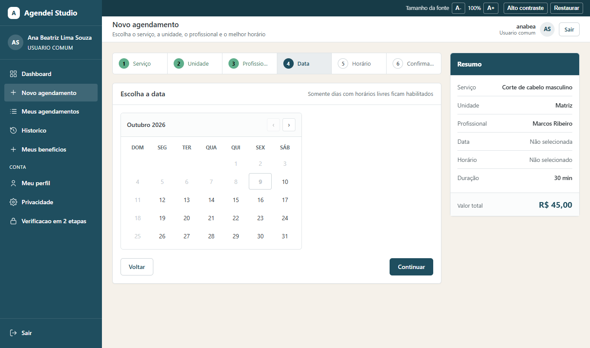
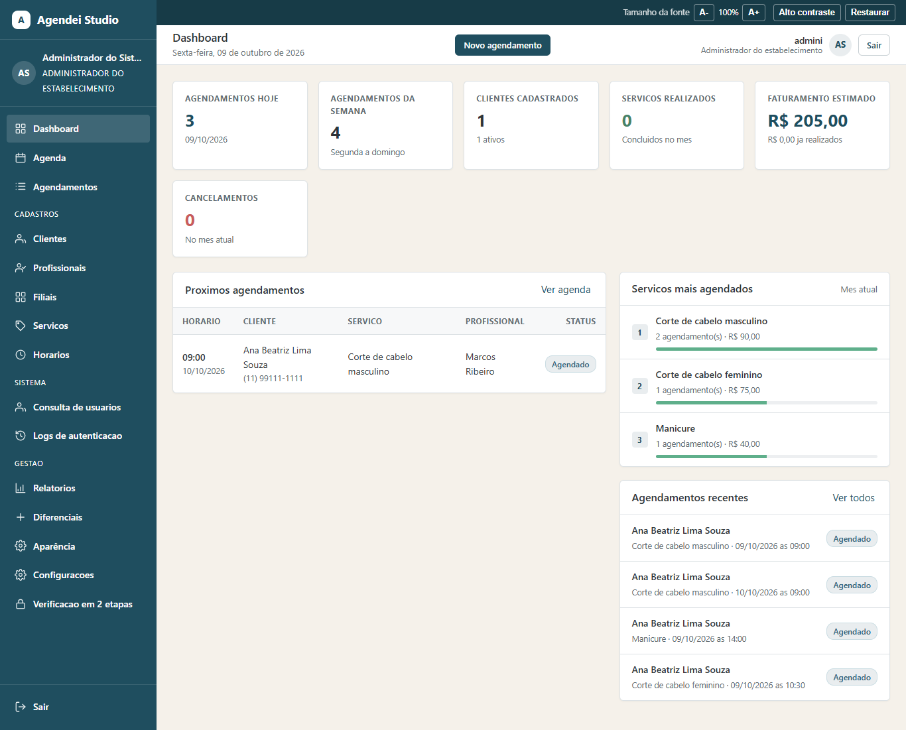
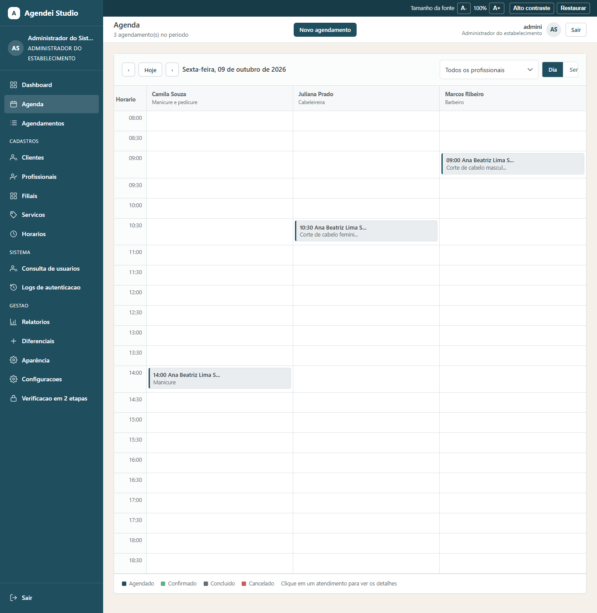
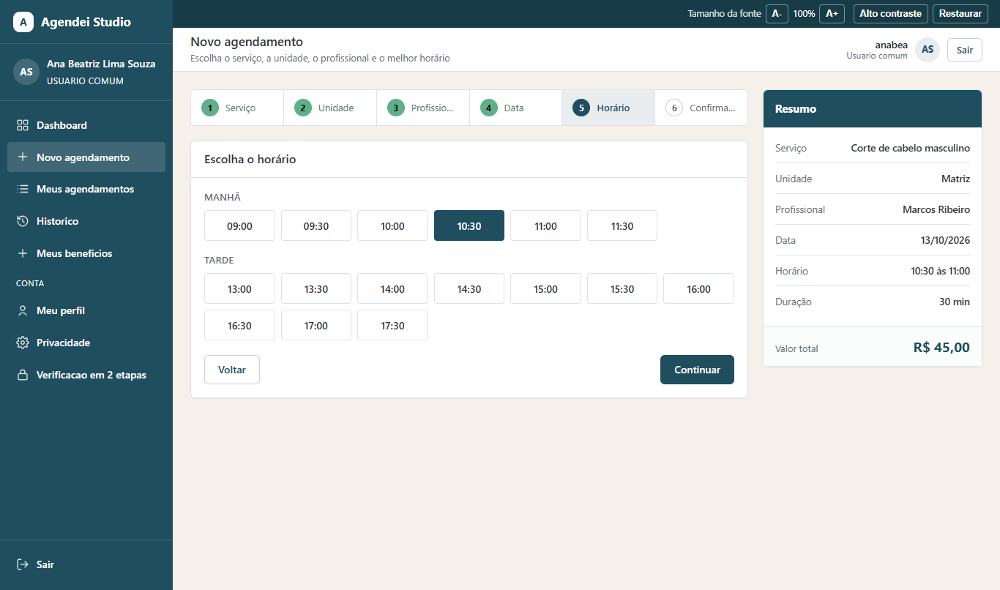
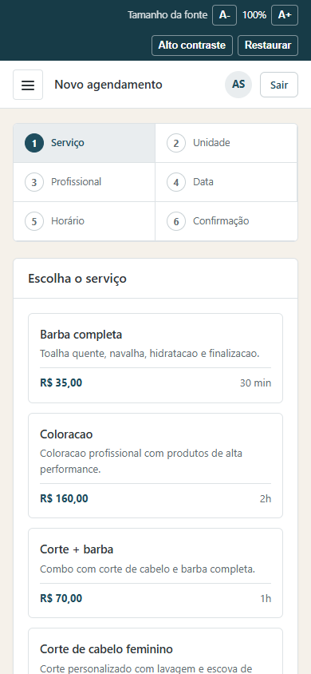

# Agendei

Sistema web de agendamento para barbearias, salões e clínicas. Vários
estabelecimentos usam a mesma instalação, cada um com seus profissionais,
serviços, filiais e agenda, sem enxergar os dados dos outros.

Feito em **PHP puro, sem frameworks**, com MySQL ou PostgreSQL, e pronto para
subir com Docker.



## O que ele faz

- **Cliente** agenda em 6 passos (serviço, unidade, profissional, data, horário,
  confirmação) e só vê dias e horários que estão realmente livres.
- **Administrador** controla agenda, profissionais, serviços, expedientes,
  filiais, relatórios e configurações de cada estabelecimento.
- **Lembretes por WhatsApp** automáticos, com confirmação de presença pelo link
  e liberação do horário quando o cliente não responde.
- Lista de espera, sinal via Pix, agendamento recorrente, fidelidade, pacotes,
  comissão por profissional, avaliações e feed iCalendar (Google Agenda, Outlook).
- Login com Google, "manter conectado" e **verificação em duas etapas (TOTP)**.
- Privacidade: o cliente baixa os próprios dados ou encerra a conta com
  anonimização.
- Barra de acessibilidade (alto contraste e tamanho de fonte) em todas as telas.

## Destaques técnicos

- **Multi-empresa (multi-tenant)**: o vínculo com o estabelecimento está em
  todas as tabelas, e as chaves do banco impedem misturar dados de empresas
  diferentes.
- **Regras de negócio validadas no servidor**: sem conflito de horário, sem
  agendamento fora do expediente, em horário bloqueado ou fora da antecedência
  permitida. O JavaScript só melhora a experiência.
- **Segurança**: `password_hash`, PDO com prepared statements, token CSRF em
  todos os formulários, saída escapada e controle de acesso por perfil.
- **Testes** em PHP puro, com banco temporário criado e descartado a cada
  execução (isolamento entre empresas, 2FA, lembretes, login com Google...).
- Gerador de PDF próprio, sem bibliotecas externas.

## Telas

| Painel do administrador | Agenda |
|---|---|
|  |  |
| **Horários livres** | **Celular** |
|  |  |

Todas as telas: [TELAS.md](TELAS.md).

## Rodando localmente

```bash
mysql -u root -p < banco.sql          # cria o banco com dados de exemplo
# ajuste as credenciais em config/database.php
# abra http://localhost/agendei/instalar.php e clique em "Executar instalacao"
```

Acessos de demonstração, PostgreSQL e Docker: [LEIAME.md](LEIAME.md).
Publicação em hospedagem: [DEPLOY.md](DEPLOY.md).

```bash
php tests/multitenancy.php   # exemplo: isolamento entre estabelecimentos
```

## Tecnologias

PHP 8 · MySQL / PostgreSQL · HTML, CSS e JavaScript puros · Docker · Render · Supabase
